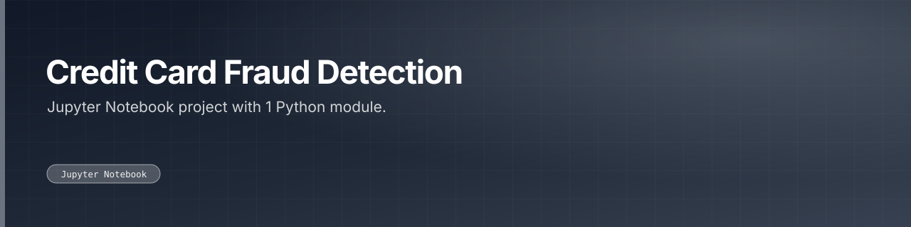

Classification study detecting fraudulent card transactions on an imbalanced dataset, with dataset cleaning and class-distribution analysis.

 

 

---

## What this is

A binary-classification exercise on credit-card fraud, where the interesting problem is class imbalance rather than the model. Uses `collections` to inspect the class distribution and a `clean_dataset` step before training, with matplotlib for visualisation.

|  |  |
|:--:|:--:|
| **1** | **1** |
| Python modules | docs |

---

<a href="https://github.com/gowtham-creator/credit-card-fraud-detection">gowtham-creator/credit-card-fraud-detection</a>

